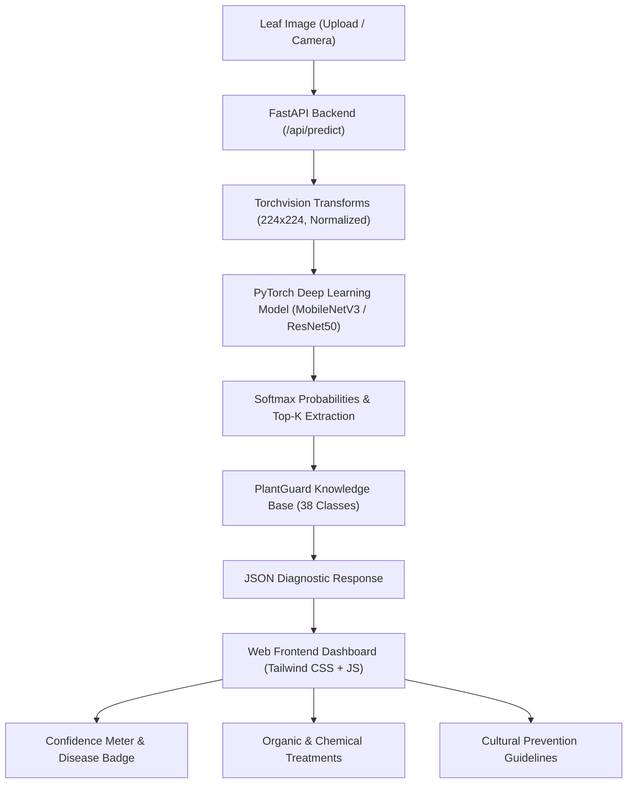

# 🌿 PlantGuard AI - Plant Leaf Disease Detection System

An end-to-end, production-grade Deep Learning system for identifying crop diseases from leaf photographs, complete with a high-performance **FastAPI backend** and a modern **interactive web frontend**.

---

## 📌 System Architecture



---

## 📁 Project Directory Structure

```text
plant leaf disease detections system/
├── plantguard_plant_disease_labels.csv   # Ground-truth 38-class reference metadata
├── requirements.txt                      # Project Python dependencies
├── download_dataset.py                   # Automated PlantVillage dataset downloader
├── train.py                              # PyTorch transfer learning model training script
├── evaluate.py                           # Precision, Recall, F1-Score & confusion matrix
├── backend/
│   ├── app.py                            # FastAPI application serving REST endpoints & static web UI
│   └── disease_knowledge.py              # Full agronomic knowledge base (symptoms, organic/chemical cures)
├── frontend/
│   ├── index.html                        # Modern single-page web app (drag-and-drop, camera snapshot)
│   ├── styles.css                        # Glassmorphic and responsive styling
│   └── app.js                            # Interactive frontend logic, camera capture, API client
└── models/                               # Saved model weights (.pth, .onnx, classes.json)
```

---

## 🚀 Quickstart Guide

### Step 1: Install Dependencies

```bash
pip install -r requirements.txt
```

*(Note: PyTorch wheels for Windows are available via standard pip or from [pytorch.org](https://pytorch.org)).*

---

### Step 2: Download PlantVillage Dataset

The model trains on the **PlantVillage dataset**, which contains 54,303 leaf images spanning 38 classes (Apple, Tomato, Potato, Corn, Grape, Peach, Bell Pepper, etc.).

**Option A — Automated Download via kagglehub:**
```bash
python download_dataset.py
```

**Option B — Kaggle CLI:**
```bash
kaggle datasets download -d emmarex/plantdisease
# Unzip contents into: ./data/PlantVillage/
```

**Directory Structure Required:**
```text
data/
└── PlantVillage/
    ├── Apple___Apple_scab/
    ├── Apple___Black_rot/
    ├── Apple___Cedar_apple_rust/
    ├── Apple___healthy/
    ├── Blueberry___healthy/
    ├── ...
    └── Tomato___healthy/
```

---

### Step 3: Train the Deep Learning Model

Run the training pipeline. By default, it uses **MobileNetV3-Large** (pre-trained on ImageNet), which achieves >98% accuracy while maintaining <25ms inference latency:

```bash
# Default training (MobileNetV3, 15 epochs, batch size 32)
python train.py --data-dir ./data/PlantVillage --epochs 15 --batch-size 32

# Alternative architectures: ResNet50 or EfficientNet-B0
python train.py --arch resnet50 --epochs 15
python train.py --arch efficientnet_b0 --epochs 15
```

**What happens during training:**
1. Loads all 38 classes and saves index mapping to `models/class_indices.json`.
2. Applies robust augmentations (Random Horizontal/Vertical Flips, Rotations, Color Jitter).
3. Trains with **AdamW** and **CosineAnnealingLR** scheduler.
4. Uses **Automatic Mixed Precision (AMP)** for ultra-fast GPU acceleration.
5. Saves the best checkpoint to `models/best_model.pth`.
6. Exports cross-platform **ONNX** model to `models/plant_disease_model.onnx`.

---

### Step 4: Evaluate Model Performance

Calculate test accuracy, precision, recall, and F1-score across all 38 classes:

```bash
python evaluate.py --checkpoint ./models/best_model.pth --test-dir ./data/PlantVillage/val
```

---

### Step 5: Start Backend and Open Frontend

Run the FastAPI application with Uvicorn:

```bash
uvicorn backend.app:app --host 127.0.0.1 --port 8000 --reload
```

Once running:
- **Web App**: Open [http://127.0.0.1:8000](http://127.0.0.1:8000) in your browser.
- **Interactive Swagger API Docs**: Open [http://127.0.0.1:8000/docs](http://127.0.0.1:8000/docs).

> 💡 **Demo / Simulation Mode**: If you run the server before training the full model, the backend automatically operates in **Demo Mode**, allowing you to test image uploads, camera snapshots, treatment tabs, and the 38-class Disease Encyclopedia immediately.

---

## 🌐 REST API Endpoints

| Method | Endpoint | Description |
|---|---|---|
| `POST` | `/api/predict` | Uploads a leaf image file (`multipart/form-data`) and returns complete pathology diagnosis, confidence, and treatment guidelines |
| `GET` | `/api/diseases` | Returns the encyclopedia catalog of all 38 classes with search and filtering by plant and category |
| `GET` | `/api/disease/{id}` | Returns clinical advisory for a specific disease class ID (0–37) |
| `GET` | `/api/health` | Returns backend telemetry, compute device (CPU/CUDA), and model status |

---

## ☁️ Live Deployments

- 🌐 **Frontend (Vercel):** [https://plant-leaf-disease-detection-system-five.vercel.app](https://plant-leaf-disease-detection-system-five.vercel.app)
- ⚙️ **Backend API (Render):** [https://plant-leaf-disease-detection-system-snr3.onrender.com](https://plant-leaf-disease-detection-system-snr3.onrender.com)
- 📖 **Interactive Swagger Docs:** [https://plant-leaf-disease-detection-system-snr3.onrender.com/docs](https://plant-leaf-disease-detection-system-snr3.onrender.com/docs)
- 📦 **GitHub Repository:** [https://github.com/rajeshrakshit-ops/plant-leaf-disease-detection-system](https://github.com/rajeshrakshit-ops/plant-leaf-disease-detection-system)

---

## ☁️ Deployment Guide

### Deploy Backend to Render (https://render.com)

1. Push your project to GitHub.
2. Sign in to [Render Dashboard](https://dashboard.render.com).
3. Click **New +** > **Web Service** > Connect your GitHub repository.
4. Configure service settings:
   - **Name**: `plant-leaf-disease-detection-system`
   - **Environment**: `Python`
   - **Build Command**: `pip install -r backend/requirements.txt`
   - **Start Command**: `uvicorn backend.app:app --host 0.0.0.0 --port $PORT`
   - *(Optional Blueprint)*: Alternatively, use **New +** > **Blueprint** and Render will automatically detect [`render.yaml`](file:///c:/Users/rajes/OneDrive/Desktop/plant%20leaf%20disease%20detections%20system/render.yaml).
5. Click **Create Web Service**.
6. Render URL: `https://plant-leaf-disease-detection-system-snr3.onrender.com`.

---

### Deploy Frontend to Vercel (https://vercel.com)

1. Sign in to [Vercel Dashboard](https://vercel.com).
2. Click **Add New...** > **Project** > Import your GitHub repository.
3. Configure project settings:
   - **Root Directory**: `frontend` (or leave as root `/` with `outputDirectory: frontend` in [`vercel.json`](file:///c:/Users/rajes/OneDrive/Desktop/plant%20leaf%20disease%20detections%20system/vercel.json))
   - **Framework Preset**: `Other`
4. [`vercel.json`](file:///c:/Users/rajes/OneDrive/Desktop/plant%20leaf%20disease%20detections%20system/vercel.json) automatically proxies `/api/*` to `https://plant-leaf-disease-detection-system-snr3.onrender.com`.
5. Click **Deploy**.
6. Vercel URL: `https://plant-leaf-disease-detection-system-five.vercel.app`.


